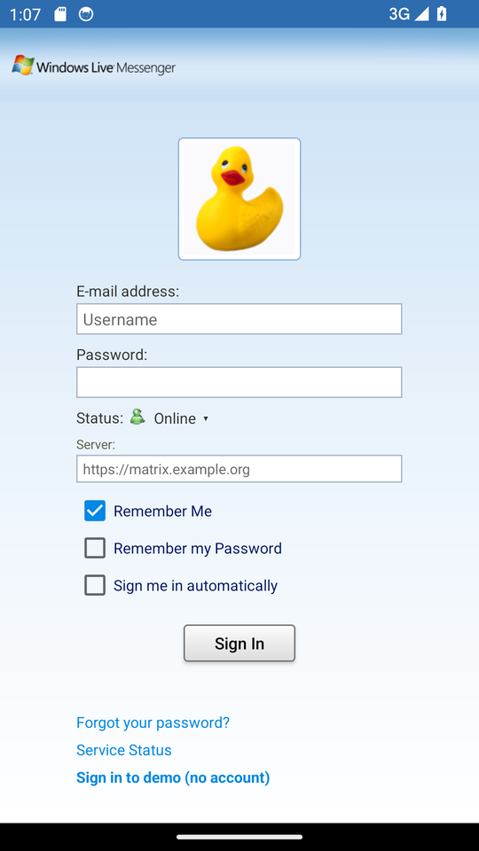
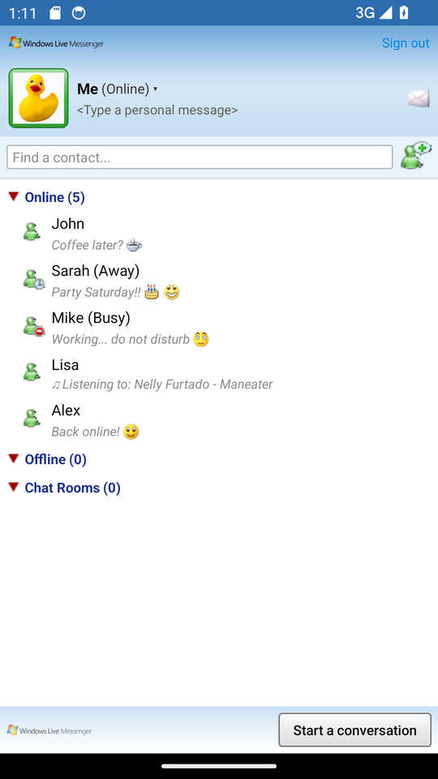
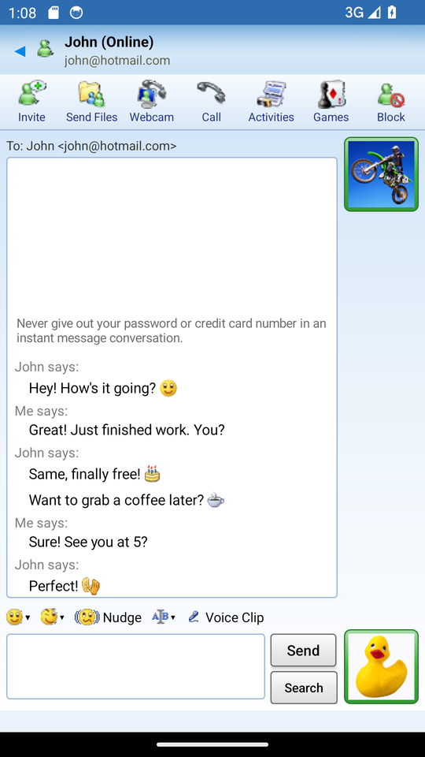
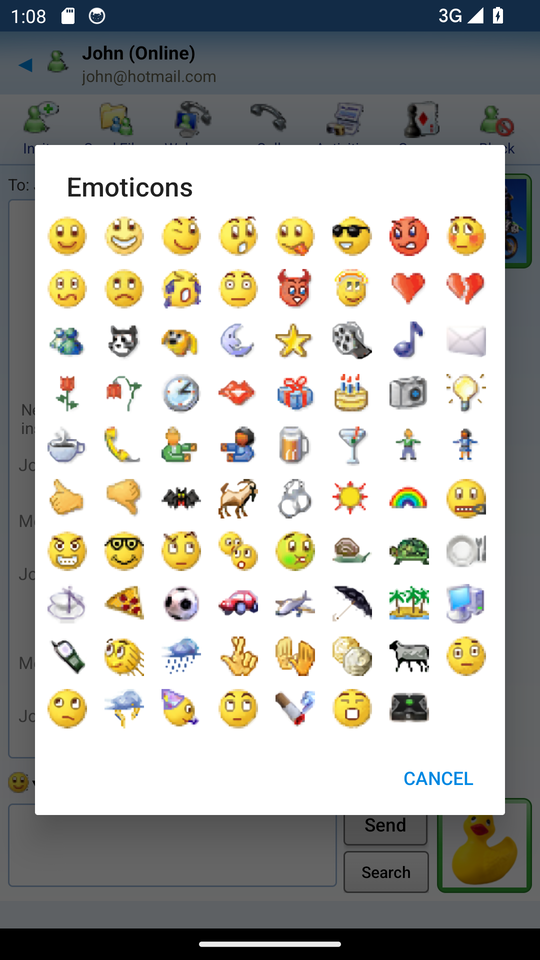
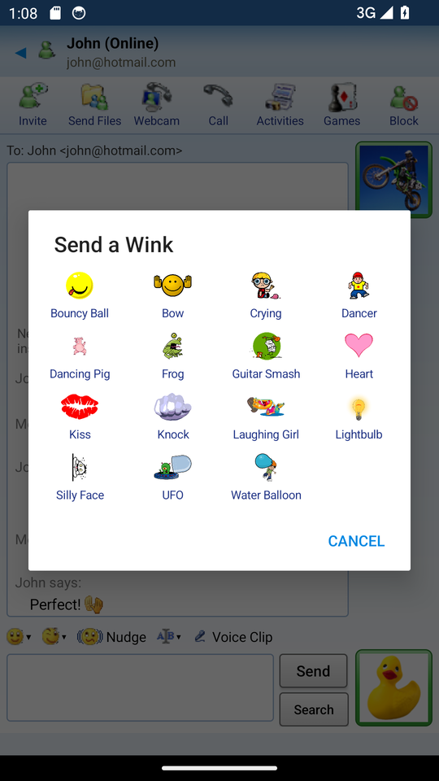
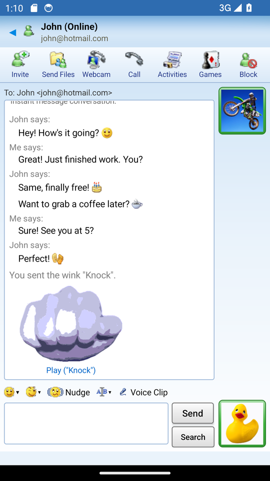
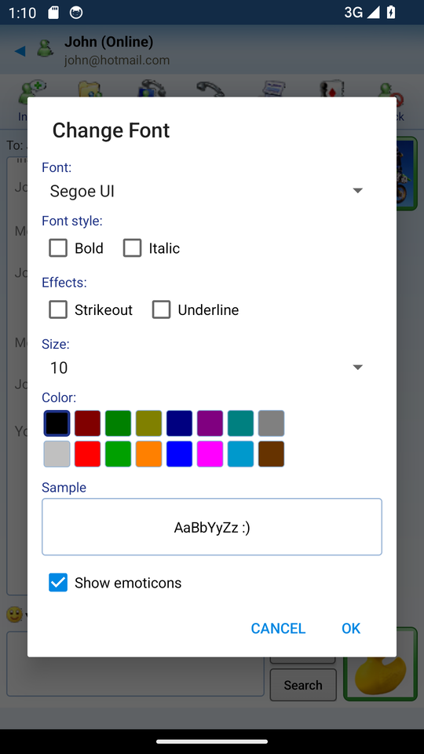

<div align="center">

# MSN Messenger 8 for Android

**A faithful recreation of MSN Messenger 8 for Android, powered by Matrix.**


<a href="https://www.buymeacoffee.com/Gmorb" target="_blank"></a>

</div>

---

A native Android app that recreates the look and feel of MSN Messenger 8: the sign-in screen, contact list, conversation window, emoticons, winks, nudges and sounds. Messages travel over any **Matrix** homeserver, so it also talks to Element and other Matrix clients.

> **Bring your own installer.** This repository and its release APKs contain **no Microsoft artwork, sounds or winks**. On first start, the app asks for your own copy of the **MSN Messenger 8** installer and sets up the original icons, emoticons, display pictures, sign-in animation, sounds and the 15 default winks on the phone. The installer is only read, nothing is installed.

## Screenshots

<table>
  <tr>
    <td align="center"><br><b>Sign-in</b></td>
    <td align="center"><br><b>Contact list</b></td>
    <td align="center"><br><b>Conversation</b></td>
  </tr>
  <tr>
    <td align="center"><br><b>Emoticons</b></td>
    <td align="center"><br><b>Send a Wink</b></td>
    <td align="center"><br><b>Tap-to-replay winks</b></td>
  </tr>
  <tr>
    <td align="center"><br><b>Change Font</b></td>
  </tr>
</table>

<sub>Screenshots taken in demo mode on an Android 14 emulator, after importing an MSN Messenger 8 installer.</sub>

## Getting started

1. Download the APK from the [**Releases**](../../releases) page and install it.
2. Open the app and tap **Choose installer...**. Pick your `MSN Messenger 8.exe`, the `MsnMsgs.msi` inside it, or a `.zip` containing either.
3. Wait a few seconds while the app unpacks the installer. Afterwards it offers to add an **MSN Messenger** shortcut with the original icon to your Home screen.
4. Sign in with your Matrix account. The server field is empty, so enter your own homeserver.

Extra winks can be added at any time from a chat: tap **Wink**, then **Import winks...**, and choose `.mco` wink packages, `.swf` files or a `.zip` of them.

## What the importer sets up

| Content | Source inside the installer |
| --- | --- |
| Toolbar, composer, presence and status icons, skin images | `msgsres.dll` (custom RLE skin images, decoded on the phone) |
| 79 emoticons and the 12 display pictures | `msgsres.dll` |
| 32-frame spinning-buddies sign-in animation | `msgsres.dll` |
| App, alert and message icons | Icon resources |
| 10 sounds, including ring and hang-up | WMA files, converted on the phone |
| 15 default winks with thumbnails | Wink cabinets embedded in `msgslang.dll` |

Until the import is done, the app shows blank placeholders.

## Features

### Messenger 8 look and feel

| Area | What it does |
| --- | --- |
| **Original artwork** | Toolbar, composer, presence and status icons from your installer, in their original colours |
| **Sign-in animation** | The original 32-frame spinning buddies |
| **Emoticons** | 79 MSN emoticons, upscaled for high-density screens, with a *Show emoticons* toggle |
| **Winks** | Flash winks played full screen through Ruffle. Missed winks play when the chat opens, and each has a transparent *Play ("Name")* replay thumbnail |
| **Nudges** | Window shake and the nudge sound |
| **Sounds** | Sign-in, message, nudge, alert, phone and file-transfer sounds |
| **Change Font** | The MSN 8 dialog: font, bold, italic, underline, strikeout, size 8–20 and the 16 classic colours. Sent to contacts, with HTML formatting for Element |
| **Voice Clips** | Hold to talk, up to 15 seconds, sent as Matrix voice messages |
| **Security notice** | *"Never give out your password or credit card number…"* at the start of each conversation |

### Messaging

| Area | What it does |
| --- | --- |
| **Sign-in** | Plain username, full Matrix ID or e-mail. Status picker, *Remember Me*, *Remember my Password* and *Sign me in automatically*. Your last display picture is shown |
| **Contact list** | Online, Offline and **Chat Rooms** groups, status icons, personal messages and live presence |
| **Status** | Online, Busy, Be Right Back, Away, In a Call, Out to Lunch and Appear Offline, synced with Matrix presence. Automatic *Away* after inactivity |
| **Display pictures** | 12 MSN pictures, a custom photo or your Matrix avatar, with status-coloured frames |
| **Conversations** | Live updates through Matrix `/sync`, typing indicator, sign-in pop-ups with pictures |
| **Camera** | *Take a Photo* and *Record a Video* from **Send Files**, sent straight to the chat |
| **Media and files** | Large inline images and videos, a full-screen viewer, and saving of **any file type** to `Downloads/MSN Messenger` |
| **Notifications** | A background service keeps you signed in and groups notifications per conversation |
| **Languages** | English, Spanish and French, following the phone's language |
| **Demo mode** | *Sign in to demo (no account)* with simulated contacts |

## Requirements

- Android 6.0 or later (minSdk 23, targetSdk 34)
- Your own copy of the **MSN Messenger 8** installer
- A Matrix homeserver with password login enabled, such as Synapse. Presence must be enabled for live status

## Build

You need the Android SDK, **NDK 26.3.11579264** and **CMake 3.22.1** (for the native WMA and cabinet decoders).

```bash
# Android SDK path in local.properties (not committed)
echo "sdk.dir=$HOME/Android/Sdk" > local.properties
./gradlew assembleDebug -PnoAssets -PnoServer
# output: app/build/outputs/apk/debug/app-debug.apk
```

Install it with `adb install -r app/build/outputs/apk/debug/app-debug.apk`.

`-PnoAssets` builds the asset-free version with blank placeholders, which the importer fills from your installer. `-PnoServer` leaves the sign-in server field empty. GitHub release APKs are always built with both switches.

### Default server (optional)

To pre-fill the sign-in server in your own builds, add this line to the git-ignored `local.properties` and build without `-PnoServer` (keep `-PnoAssets`):

```
msn.server=https://matrix.example.org
```

## Project layout

| Path | Contents |
| --- | --- |
| `app/src/main/java/com/msnmessenger/` | Activities (Import, Login, Main, Chat, MediaViewer), `Winks`, `Emoticons`, `Avatars`, `AssetStore`, `HomeShortcut`, `I18n`, `NotifyService`, `BootReceiver` |
| `app/src/main/java/com/msnmessenger/imp/` | On-phone installer importer: MSI and cabinet reading, RLE skin decoder, icon and wink extraction |
| `app/src/main/cpp/` | Native decoders: a cut-down FFmpeg WMA decoder and libmspack for LZX cabinets |
| `app/src/main/res/` | Layouts, XML drawables and translations (`values-es`, `values-fr`) |
| `app/src/placeholder/res/` | Blank placeholder images replaced by the import |
| `app/src/main/assets/ruffle/` | Ruffle self-hosted Flash player |
| `i18n/` | Translation sources (`es.json`, `fr.json`) |
| `gen_i18n.py`, `i18n_tool.py` | Translation resource generator and source wrapper |
| `docs/screenshots/` | README images |

## Adding a language

1. Copy `i18n/es.json` to `i18n/<lang>.json` and translate the values.
2. Run `python3 gen_i18n.py <lang>`. This writes `res/values-<lang>/`.
3. Add `res/values-<lang>/wink_strings.xml` for the *Play ("%1$s")* caption.

## Matrix message conventions

These plain-text markers keep the app compatible with other clients such as Element:

| Event | Body |
| --- | --- |
| Wink | `*wink:<Name>*` |
| Nudge | `*nudge*` |
| Voice clip | `m.audio` with voice-message metadata |
| Status and personal message | `status_msg` = `[Busy] message` (Online sends the message only) |

## Support the project

MSN Messenger 8 for Android is free and built in my spare time. If you enjoy it, a coffee helps cover the costs of maintaining it, such as the **Claude API usage** behind the reverse engineering, bug fixes and new features, and the **time** I spend testing and improving the app.

<a href="https://www.buymeacoffee.com/Gmorb" target="_blank"></a>

Every donation is appreciated, and the app will always stay free. Thank you!

## Credits and licences

- Flash playback: [Ruffle](https://ruffle.rs) (Apache-2.0 / MIT)
- WMA decoding: [FFmpeg](https://ffmpeg.org) (LGPL-2.1+)
- Cabinet decompression: [libmspack](https://www.cabextract.org.uk/libmspack/) (LGPL-2.1)
- MSN Messenger artwork, sounds and winks remain the property of Microsoft and their respective owners. They are not distributed with this project and are read only from the user's own installer.

<div align="center"><sub>Not affiliated with or endorsed by Microsoft. MSN and Windows Live are trademarks of Microsoft Corporation.</sub></div>
